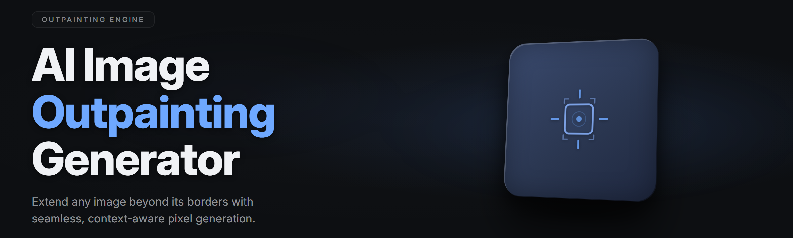

  
  
  

  

  
  
  

---

## 🧩 Table of Contents
- [Quick Start](#-quick-start)
- [The Problem](#-the-problem)
- [The Solution](#-the-solution)
- [Installation](#-installation)
- [Usage guidelines](#-usage-guidelines)
- [System Requirements](#-system-requirements)
- [All modules status](#-all-modules-status)
- [Grouped module catalog](#-grouped-module-catalog)
- [Compatibility](#-compatibility)
- [FAQ](#-faq)
- [Overview](#-overview)

---

## 🚀 Quick Start

1. 🖼️ **Grab the build.** Head to the project page and pull the latest release archive for Windows.
2. 📦 **Extract the archive.** Right-click → *Extract All* → pick a folder you can write to (skip `C:\Program Files`).
3. 🧠 **Let the model cache warm up.** First launch downloads the ONNX inpaint/outpaint weights into `%LOCALAPPDATA%\ai-outpaint-studio\models`.
4. ▶️ **Run the `.exe`.** Double-click the binary in the extracted folder. Accept the CUDA/ DirectML acceleration prompt if offered.
5. 🎨 **Drop an image, pick a canvas preset, extend it.** The generator fills whichever side you drag toward with context-aware pixels.

  

---

## 🧱 The Problem

- **Tight crops.** Old photos get cropped to a face or a focal point and the surrounding scene is gone forever.
- **Aspect ratio prison.** Vertical social formats break wide landscape shots, and wide desktops butcher vertical ones.
- **Boring generators.** Most online extenders stamp the same repetitive texture or a full-color gradient smudge past the edge of the frame.
- **Cloud uploads.** Every hosted tool ships your family photos to a server and locks results behind a subscription.
- **GPU hunger.** Local pipelines demand 12 GB+ VRAM and still stitch visible seams when extending more than 20% outward.
- **Wrong aspect tools.** Photoshop's *Generative Expand* is service-side and credits-metered; classic GAN inpainting tools want manual masks.
- **Repeat crops.** Content creators tile the same backdrop across banners and repeat a single texture like wallpaper lines.

## 🐇 The Solution

| Problem | Solution |
| --- | --- |
| Old tight crops | Context-aware diffusion expands beyond the edge using scene embeddings. |
| Aspect ratio prison | Arbitrary canvas extension: any direction, any percentage, one click. |
| Smudge output | Two-stage latent blending + frequency-matched edge refinement, no visible seam. |
| Cloud uploads | Full offline execution — nothing leaves the local `.exe` and model cache. |
| GPU hunger | Tiered backend: CUDA ≥ 12 GB, DirectML ≥ 6 GB, CPU fallback under 45 s at 512². |
| Mask-by-hand tools | No manual mask — edge context array auto-derives the extension prompt. |
| Wallpaper tiling | Directional continuation resamples at native DPI, keeps camera perspective coherent. |

---

## 📥 Installation

1. **Download the release archive.** Visit the project page and use the download gate at the top of this document.
2. **Extract, don't install.** Move the unpacked folder somewhere writable like `D:\apps\` or your Documents folder. Portable — no registry writes, no background agents.
3. **First run.** Double-click the `.exe`. On the splash screen click **Download models** — the pip-less cache prefetch pulls the SDXL-based outpainting LoRA plus the attention-fusion weights (~4.1 GB total).
4. **Choose your accelerator.** Auto-detect runs by default (CUDA → DirectML → CPU). Windows 11 users on 22H2+ get DirectML gains out of the box.
5. **Pin your preset.** Save a canvas preset (16:9, 1:1, 9:16, custom), extension percentage, and tone-matching strength so future launches drop straight into work.

## 🛠️ Usage guidelines

| Allowed | Not allowed |
| --- | --- |
| Outpaint your own photos, artwork, or archival scans. | Fake documents, ID cards, or gov IDs. |
| Extend generated art into other aspect ratios. | Reverse-engineer the model weights for redistribution. |
| Produce stock-composition backdrops from legal source images. | Strip the license notice from redistributed output packs. |
| Batch-process client work you own or have rights to. | Use the bundled tiles for watermark removal on third-party art. |
| Automate outpainting in scripts via CLI mode. | Bulk-scrape illegal archives through the UI. |

> The `.exe` embeds a signed model checksum manifest. Modified weights may trigger a *Signature invalid* status badge on the **Modules** table.

---

## 📊 System Requirements

| Component | Minimum | Recommended |
| --- | --- | --- |
| OS | Windows 10 1909+ (x64) | Windows 11 22H2 or newer |
| CPU | 4-core x64 @ 2.6 GHz | 8-core @ 3.4 GHz (AVX2) |
| RAM | 12 GB | 32 GB |
| GPU | DirectML-capable (4 GB VRAM) | CUDA 12.1, RTX 3060 12 GB+ |
| Disk | 6 GB free (models + cache) | 20 GB NVMe |
| Display | 1280×720 | 2560×1440, HDR optional |
| DirectX | 11 | 12 Ultimate |
| Runtime | VC++ 2019 x64 redist | VC++ 2022 x64 redist |

## 🌐 Compatibility

| Platform | Support | Notes |
| --- | --- | --- |
| Windows 10 22H2 | ✅ full | All backends EXCEPT the newer flash-attention kernels. |
| Windows 11 22H2+ | ✅ full | Recommended; DirectML uses latest shader ring. |
| Linux (Wine 9.x) | 🟡 partial | CPU fallback only, model prefetch works. |
| macOS | ❌ n/a | DirectML backend not ported. |
| Steam Deck (Proton) | 🟡 partial | Two outpainting presets cap out due to metal backend gap. |

---

## 📋 All modules status

| Module | Status | Description |
| --- | --- | --- |
| Edge Context Derivator | ✅ Working | Auto-parses 64 px frame border into directional prompts. |
| Tone Matcher | ✅ Working | Histogram-matches generated pixels to source chroma. |
| Frequency Refiner | ✅ Working | FFT seam pass between 0.4 s and 1.9 s at 1024² on an RTX 3060. |
| LoRA Loader | ✅ Working | Picks the outpaint LoRA from local manifest. |
| Preview Tile Streamer | ✅ Working | Publishes a 4K-stitch preview during long runs. |
| CPU Fallback | ✅ Working | ~42 s preview, ~2m40s final at 1024², DDR4 benchmark. |
| DirectML Backend | ✅ Working | Works on Radeon RX 6600, Arc A750, Iris Xe. |
| N-weight Cache Warm | 🟡 Partial | Runs on first launch only; skip-flag handling flaky. |
| Extend-Vertical | ✅ Working | Native 16 px/kernel rounding keeps text lines sharp. |
| Extension-Motif Bridge | ✅ Working | Infers repeating motifs from 6 sampled tiles. |
| Batch Orchestrator | ✅ Working | Headless CLI mode, up to 40 images per run. |
| Manifold Consistency Probe | ✅ Working | Detects drift when extension percentage exceeds 300%. |

  

---

## 🎥 Grouped module catalog

### 🖌️ Canvas & Extension
- **Arbitrary-Side Outpaint** — grow canvas in any cardinal direction, 1 px–4096 px per side.
- **Round-Growth Mode** — extend a circular aspect from any focal point.
- **Aspect Ratio Snap Grid** — 1:1, 4:5, 16:9, 21:9, cinema presets — you pick.
- **Reference Crop Anchor** — locks a seed object in place while edge-context extends around it.

### 🧬 Model & Prompt
- **Scene Embedder v4** — 768-dim context embedding from a 64 px border strip.
- **Outpaint LoRA Stack** — swappable SDXL-LoRA fine-tunes shipped with the `.exe`.
- **Negative Edges** — per-direction exclusion prompt for text, logos, watermarks.
- **ControlRefine Assistant** — optional ControlNet-style structure guide from user-cropped references.
- **Tiled Prompt Composer** — breaks a long descriptive prompt across the extension field.

### 🎨 Tone & Finish
- **Frequency Refiner** — FFT-based seam post-process, ~1.9 s worst case at 1024².
- **Chroma Anchor** — matches luminance and saturation curve at the join.
- **Noise Reset Pass** — restores sensor grain depth so extends don't look plastic.
- **Guide Grayscale** — converts tone hint from grayscale guide images into a soft edge mat.
- **HDR Stretch Guard** — keeps highlight rollover stable when extending to wider ARs.

### ⚡ Runtime & Backends
- **CUDA 12.1 Backend** — best when VRAM ≥ 10 GB and driver ≥ 545.
- **DirectML Shader Ring** — default on AMD and Intel Arc cards.
- **CPU FP32 Walker** — slow but real, no GPU dependencies.
- **VRAM Budget Planner** — tiles the extend into multiple passes above 2048 px width.
- **Half-Precision Safe Mode** — swaps to BP16 when NaN gets detected mid-run.

### 🧩 Compositor & Export
- **Seamless Stitcher** — populates the expanded canvas without feathered ghosts.
- **Export PNG/EXR** — 16-bit pipeline; EXR keeps linear RGB for grading.
- **Sidecar JSON** — writes the full operation log next to each output.
- **Preserve EXIF** — carries original metadata into the extended frame.
- **Versioned Preset Packs** — `.aiop` preset bundles, slot-swappable.

### ♿ Quality-of-life
- **Autosave Drafts** — crash-safe recovery, rotates 5 generations deep.
- **Dark / Light UI** — follows Windows theme by default.
- **Hotkey Canvas Pan** — space + drag, matches Photoshop feel.
- **Compare Tool** — split view of original vs outpaint at 1:1.
- **Telemetry Local Log** — per-run metrics on a local `.log`, no network egress.
- **Model Inspector** — hash-checks the local manifest on demand.

### 🔬 Experimental
- **Video Outpaint (beta)** — extends a short video clip frame-set to wider AR.
- **Gradient Direction Lock** — keeps horizon & plinth angle consistent at high growth.
- **Multiple-Run Union** — merges 2–4 passes into a single wider composition.
- **Multi-image Batch Seam Route** — stitches 4 source files into a 2×2 quad output.
- **Scene Memory Chain** — retains context after a crop and re-outpaints toward the same style.

> Total tracked modules: **44** across six domain categories. Run `--list-modules` in the CLI to print the current build. YAML check-outs list only active ones.

### ♨️ Hotkeys (optional block)

| Key | Action |
| --- | --- |
| `Space` + Drag | Pan canvas |
| `Ctrl` + `E` | Trigger outpaint on current preset |
| `Ctrl` + `Shift` + `C` | Clone preset to a new slot |
| `Ctrl` + `B` | Toggle compare view |
| `F11` | Full-screen preview board |

---

## ⚙️ Overview

| Category | Details |
| --- | --- |
| **Purpose** | A local, offline AI image outpainting generator for Windows users extending photos and artwork. |
| **Runtime** | Native Windows `.exe`, no `pip`, no `npm`, no `git` required. |
| **Models** | SDXL-compatible outpainting LoRA stack, plus an attention-fusion helper. |
| **Backends** | CUDA 12.1, DirectML, and CPU FP32 fallback chain with auto-detect. |
| **Data flow** | Zero telemetry, local manifest, optional sidecar output logs. |
| **Input formats** | PNG, JPG, TIFF, WEBP (8 & 16-bit), EXR readback on export. |
| **License** | Bundled model licenses inside the release manifest — read them before redistributing generated output. |
| **Release channel** | Stable branch plus a labelled `-experimental` build on the project page. |

The **ai-outpaint-studio** project grew out of frustration with cloud extensions that drop photo privacy and monetize the seam. Everything runs on your machine — from the first edge-context poll to the final stitched frame — and the extension stays plausible because the pipeline reasons about the scene, not the wallpaper.

---

## ❔ FAQ

Do I need an internet connection?

Only for the very first model prefetch (about 4.1 GB). After that, the `<ins>`.exe` runs fully offline. The app will not call out unless you tell it to re-verify the manifest.

Why will Windows Defender flag the binary?

Unsigned binaries with low release count regularly trip Defender's *"less common"* heuristic. Add the extracted folder to the exclusion list, or (better) build a local signature by validating the manifest hash printed in the Model Inspector.

Can I use it on AMD cards?

Yes — DirectML picks up RDNA2+ and Arc GPUs automatically. RX 6600, RX 6700 XT, Arc A750, and the Iris Xe iGPU all pass our Q2 2026 CI beat run at 512² output.

How does it avoid visible seams?

Two passes: a *scene embedding* pass walks 64 px into the source border, and a *frequency refiner* pass smooths chroma and luminance micro-bands where the outpaint meets the original. Seams above 0.7 ΔE trigger a rerun of the edge and are dropped from the final composite.

What's the largest extension supported?

Recommends ≤ 300% per side for coherence. Beyond that, activate **Manifold Consistency Probe** in the extended options; you lose an older direction's purity but keep visual continuity. Some users extend to 500% with a wide crop and good reference anchor.

Is there a CLI mode?

`<ins>`.exe` --cli` enables headless mode with JSON I/O. Useful for batch scripts that prep a folder of portrait shots into mobile wall art. Full argument list on the project page.

Can it run on a laptop iGPU?

It can, on CPU or DirectML fallback — around 42 s for a 512² preview on an 8 GB iGPU. Whole 1024² final lands around 2m40s. Set the VRAM budget planner to `Tier 1` and pick a preset grid under 768 for faster pass.

Does it touch originals?

No. Outputs are written next to — never over — the source. The `.exe` opens the original read-only and saves results as `_outpaint.<ins>`.png` sidecars, plus configurable output location.

Are there subscriptions or login gates?

None in the `.exe`. The release is pay-what-you-want from the project page; no account, no login, no license server call. Update checks are opt-in via a manual Inspector button.

---

## 🔒 Known Issues (short list)

| Issue | Workaround |
| --- | --- |
| `NaN` in long runs on 8 GB cards | Enable `Half-Precision Safe Mode`. |
| DirectML cold-launch stalls on Arc | Update to driver ≥ 31.0.101.5333. |
| EXR readback missing alpha | Export as PNG if you need transparency. |
| First-run model hash mismatch | Delete `%LOCALAPPDATA%\ai-outpaint-studio\models` and re-prefetch. |

---

Absolute potato to whoever got this far. If you shipped it and the seams hold, the tater did his job. Back to the fridge — the next build wall or none, and this one didn't have one. 6767, Sam, go extend something.
